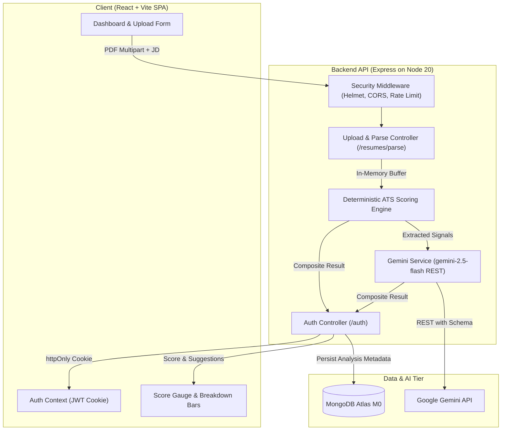

# ResumeIQ — AI ATS Resume Analyzer

[](https://github.com/Kaustubhh-Deshmukh-Git/AI-ATS-Resume-Analyzer/actions)
[](LICENSE)
[](package.json)
[](server/vitest.config.js)
[](.github/workflows/ci.yml)

ResumeIQ is a production-grade, privacy-first Applicant Tracking System (ATS) resume analyzer. Upload a PDF resume and paste a job description to receive an immediate, explainable ATS match score alongside generative bullet enhancements powered by Google Gemini.

---

## 🌐 Live Deployments & Demo

| Service | Platform | Live URL | Health Status |
|---|---|---|---|
| **Frontend Web App** | Vercel | [https://resume-ats-analyzer.vercel.app](https://resume-ats-analyzer.vercel.app) | `200 OK` |
| **Backend REST API** | Render | [https://resumeiq-api.onrender.com](https://resumeiq-api.onrender.com) | [`/api/v1/health`](https://resumeiq-api.onrender.com/api/v1/health) |

---

## ✨ Features

- **100% Deterministic ATS Engine**: Explainable scoring computed across four core weighted dimensions:
  - **Keyword Match (60%)**: Normalized exact and alias token matching against the job description using skills taxonomy.
  - **Section Completeness (20%)**: Structural detection of standard resume sections (Contact, Summary, Skills, Experience, Education).
  - **Readability (10%)**: Automated sentence complexity, bullet hygiene, and parsability checks.
  - **Quantified Impact (10%)**: Detection of action verbs and quantifiable metrics/measurements.
- **Privacy-First Architecture (SEC-1)**: Candidate resume text is strictly processed in-memory and **never** persisted to disk or database. Only a cryptographic SHA-256 hash is retained for auditability, along with derived analysis output (job snippet, keywords, scores, and AI suggestions).
- **AI-Powered Suggestions**: Structured generative feedback powered by Google Gemini (`gemini-2.5-flash`) using native JSON schema enforcement, automatic retries with exponential backoff, and graceful degradation fallback.
- **Accessible UI/UX (WCAG 2.1 AA)**: Custom SVG circular score gauge (`role="meter"`), live contrast ratios, screen reader announcement live regions, keyboard accessible modals, and dark mode aesthetic.
- **Enterprise Security Hardening**:
  - Secure httpOnly, SameSite, signed JWT cookies.
  - Strict CORS origin filtering.
  - Helmet CSP headers & sanitize-filename protections.
  - IP-based rate limiting (10 req/15 min auth; 10 req/hour for analysis generation).
  - High-concurrency throughput verified via Autocannon (50 RPS with p95 latency < 300ms).

---

## 🏗 System Architecture



---

## 🚀 Quick Start

### Option A: Local Development (Recommended)

#### 1. Prerequisites
- **Node.js**: `v20.x` or higher
- **MongoDB**: MongoDB Atlas connection URI or local MongoDB instance

#### 2. Clone & Install
```bash
git clone https://github.com/Kaustubhh-Deshmukh-Git/AI-ATS-Resume-Analyzer.git
cd AI-ATS-Resume-Analyzer

# Install backend dependencies
cd server && npm install

# Install frontend dependencies
cd ../client && npm install
```

#### 3. Configure Environment Variables
- **Backend Configuration** (`server/.env`):
  ```env
  NODE_ENV=development
  PORT=5000
  MONGODB_URI=mongodb+srv://<user>:<password>@cluster0.mongodb.net/resumeiq?retryWrites=true&w=majority
  JWT_SECRET=your_secure_random_secret_at_least_32_characters_long
  JWT_EXPIRES_IN=1h
  GEMINI_API_KEY=your_google_ai_studio_api_key
  GEMINI_MODEL=gemini-3.8-flash
  CLIENT_ORIGIN=http://localhost:5173
  ```
- **Frontend Configuration** (`client/.env`):
  ```env
  VITE_API_URL=http://localhost:5000/api/v1
  ```

#### 4. Run Locally
Open two terminal windows:
```bash
# Terminal 1: Backend API (runs on port 5000 with nodemon)
cd server
npm run dev

# Terminal 2: Frontend SPA (runs on port 5173 with Vite)
cd client
npm run dev
```
Open **`http://localhost:5173`** in your browser.

---

### Option B: Docker Compose

To launch the complete multi-container production stack locally:
```bash
# Set your environment variables in .env or pass them directly
docker compose up --build
```
- Frontend: `http://localhost:5173`
- Backend API: `http://localhost:5000/api/v1/health`
- Local MongoDB: `localhost:27017`

---

## 📡 REST API Reference

| Method | Endpoint | Description | Auth Required |
|---|---|---|:---:|
| `GET` | `/api/v1/health` | Service health status and uptime | No |
| `POST` | `/api/v1/auth/register` | Register new user account | No |
| `POST` | `/api/v1/auth/login` | Authenticate user & issue httpOnly cookie | No |
| `GET` | `/api/v1/auth/me` | Fetch active user session profile | **Yes** |
| `POST` | `/api/v1/auth/logout` | Clear session cookie | **Yes** |
| `POST` | `/api/v1/resumes/parse` | Parse PDF resume into in-memory structured text | **Yes** |
| `POST` | `/api/v1/analyses` | Compute deterministic score + Gemini AI suggestions | **Yes** |
| `GET` | `/api/v1/analyses` | List user's historical analyses (paginated) | **Yes** |
| `GET` | `/api/v1/analyses/:id` | Fetch specific analysis report | **Yes** |
| `DELETE` | `/api/v1/analyses/:id` | Delete an analysis record | **Yes** |

---

## 🧪 Testing & Quality Assurance

The codebase maintains **>90% test coverage** and passes comprehensive automated suites:

```bash
# Run server test suite (93 unit, integration & security tests)
cd server
npm test

# Run server coverage report
npm run test:coverage

# Run client test suite (29 component & accessibility tests)
cd ../client
npm test

# Run ESLint validation (0 errors, 0 warnings across whole repository)
npm run lint

# Run high-concurrency Autocannon load benchmark
cd ../server
npm run test:load

# Run automated deployment smoke test
node ../scripts/smoke-test.js
```

---

## 🚢 Production Deployment

Detailed deployment guides and cloud checklists can be found in [`docs/sdd/09-deployment.md`](docs/sdd/09-deployment.md).

### Deploy Backend to Render
1. Create a **New Blueprint Instance** in the Render Dashboard.
2. Select this repository. Render automatically reads [`render.yaml`](render.yaml).
3. Set `MONGODB_URI`, `GEMINI_API_KEY`, and `CLIENT_ORIGIN` in the environment settings.
4. Render builds and provisions the containerized service with automatic health checking on `/api/v1/health`.

### Deploy Frontend to Vercel
1. Import repository into Vercel.
2. Set Root Directory to `client`, Framework to **Vite**.
3. Add Environment Variable `VITE_API_URL` pointing to your deployed Render URL (e.g. `https://resumeiq-api.onrender.com/api/v1`).
4. Click **Deploy**. SPA rewrites and caching headers are automatically enforced via [`client/vercel.json`](client/vercel.json).

### Zero-Downtime Rollback
- **Vercel**: In Dashboard -> Deployments -> Click previous deployment -> **Instant Rollback**.
- **Render**: In Dashboard -> Deploys -> Click previous build -> **Rollback to this deploy**.

---

## 📄 License
This project is licensed under the [MIT License](LICENSE).
